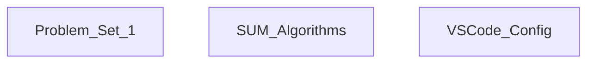

# Algorithms

> C++ algorithm and data-structure exercises from university coursework (Kadane, prefix/suffix sums, LCS, etc.).

## Overview

This project is part of the **ALPHAMAN-0** portfolio. C++ algorithm and data-structure exercises from university coursework (Kadane, prefix/suffix sums, LCS, etc.).

## Architecture / How it Works



## Tech Stack

- See source files

## How to Run

```bash
# Clone the repository
git clone https://github.com/ALPHAMAN-0/Algorithms.git
cd Algorithms
```

Open the project in your editor of choice and follow the source comments
for environment setup. Replace this section with project-specific steps
once you finalise the build.

## Folder Structure

```
Algorithms/
├── README.md
├── src/          # Source code
└── docs/         # Notes (if any)
```

## License

Released under the MIT License unless otherwise noted.

## Author

Maintained by [ALPHAMAN-0](https://github.com/ALPHAMAN-0).
